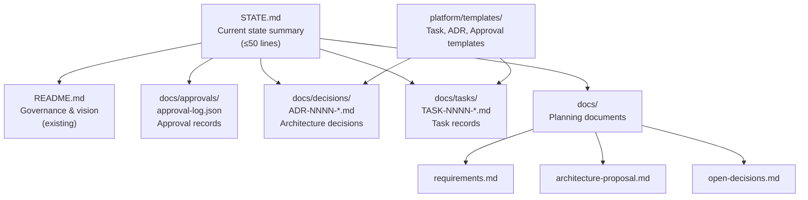
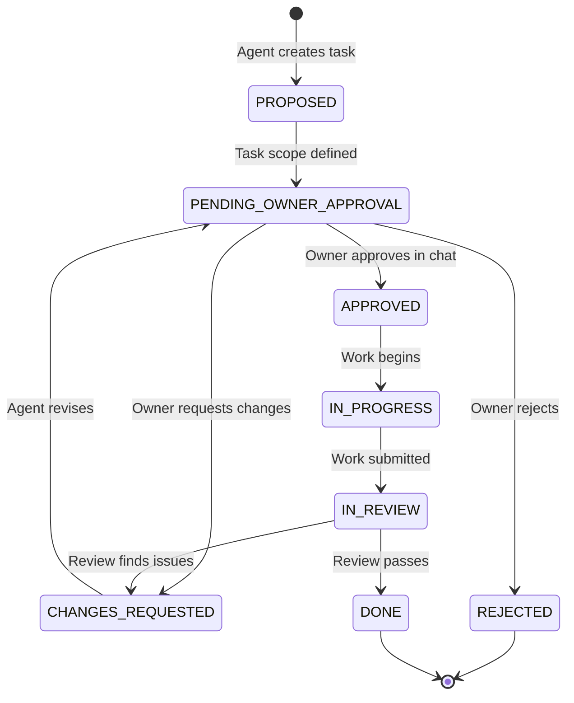

# Phase 0 Report — AI Software Company

## A. Workspace Findings

### Project Status: New (Empty) Workspace

| Item | Finding |
|---|---|
| **Workspace root** | `d:\AI Software Company` |
| **Files present** | `README.md` only (1085 lines, 46 KB) |
| **STATE.md** | Does not exist |
| **Git** | Not installed on this system |
| **Existing implementation** | None |
| **Existing planning docs** | None |
| **Hidden files** | None |

### Key Observations

1. **Git is not available.** The README's Stage A security model relies heavily on git branches, pull requests, owner-controlled branches, and repository permissions. None of these mechanisms are currently available. This is the single most important environmental limitation.

2. **The README is comprehensive and internally consistent.** The 1,085-line README covers vision, governance, agent roles, engineering standards, approval policies, frontend governance, release policies, technology evaluation criteria, and a 7-phase roadmap. No material contradictions were found between different sections.

3. **No existing work to preserve.** Since only the README exists, there is no risk of overwriting prior decisions, code, or documentation.

4. **STATE.md initialization decision.** Creating STATE.md is appropriate because: (a) the README mandates it as the first file agents read, (b) we are performing Phase 0 and can record its status, and (c) it helps future sessions resume without re-reading the full report. I will create it as part of this phase.

---

## B. Requirements Audit

### B.1 Contradictions and Ambiguities

> [!NOTE]
> No outright contradictions were found within the README. The document is unusually well-structured. The issues below are ambiguities, gaps, or requirements that need clarification.

| ID | Issue | Section | Severity |
|---|---|---|---|
| **REQ-1** | The README mandates "owner-controlled Git workflow or another independently controlled approval mechanism" (§3.2.1, line 102), but git is not installed and no repository exists. The entire Stage A approval enforcement model depends on infrastructure that is absent. | §3.2, §10.1 | **Critical** |
| **REQ-2** | The README says approval must be "enforced through workflow state, action-specific authorization, and execution permissions wherever technically possible" (§3.2, line 63). In the current environment—where the agent has full read/write access to all files and no git/CI/branch-protection exists—there is no mechanism to technically enforce anything. The enforcement gap must be explicitly acknowledged. | §3.2.2 | **Critical** |
| **REQ-3** | The README distinguishes "company-wide decisions" (under `docs/decisions/`) from "product-specific decisions" (under `products/<slug>/docs/decisions/`), but no product exists yet. It's ambiguous whether Phase 0 architecture decisions are "company-wide" or deferred until a product is active. | §11.2, line 816 | **Minor** |
| **REQ-4** | "One Active Product at a Time" (§3.4) is clear, but the workflow doesn't define what happens to the control-plane infrastructure itself—is it a "product" or a "platform"? The suggested structure (line 850) has `platform/` separate from `products/`, which resolves this implicitly, but it's not stated. | §3.4 | **Minor** |
| **REQ-5** | The learning modes (§5.4) reference tracking "actual task outcomes, review findings, and recurring patterns" but don't specify where this tracking lives in Stage A. Is it in task records? A separate file? | §5.4 | **Low** |
| **REQ-6** | "CI checks for required documentation and workflow invariants" (§10.1, line 706) assumes CI infrastructure exists. Without git, there is no CI pipeline. | §10.1 | **Medium** |
| **REQ-7** | .NET 10 is referenced as the "relevant LTS baseline" (line 478). The instruction says "verify support status before starting a new project." This is a Phase 1+ concern but worth noting: .NET 10 LTS status should be confirmed before any code is written. | §5.5 | **Low** |

### B.2 Requirements That Cannot Be Enforced

These requirements are stated as mandatory but **cannot be technically enforced** in the current environment:

| Requirement | Why Unenforceable | README Section |
|---|---|---|
| An agent must not approve its own protected action | No permission boundary prevents file edits | §3.2, line 74 |
| Approval records require authenticated owner action | No authentication mechanism exists | §3.2.1, line 102 |
| Protected execution permissions outside agent workspace | Agent has full workspace access | §3.2.2, line 116 |
| Protect approval records through owner-controlled branches | No git, no branches | §3.2.2, line 117 |
| Require review before merging changes to enforcement scripts | No merge/PR mechanism | §3.2.2, line 118 |
| Policy engine determines approval level (not the agent) | No policy engine exists | §6, line 598 |

> [!IMPORTANT]
> The README itself anticipates this in §3.2.2 (lines 108–124): "If the environment cannot reliably enforce a required approval, the system must stop the operation and explain the limitation rather than claim the action is protected." This is the correct design—acknowledge limitations rather than pretend they don't exist.

### B.3 Requirements That Are Desirable but Premature for Stage A First Iteration

| Requirement | Why Premature |
|---|---|
| CI checks for documentation and workflow invariants | No CI system; can be added when git/CI are set up |
| Lightweight validation scripts | Without branch protection, scripts can be bypassed; still useful as workflow documentation |
| Multiple approval states (EXPIRED, REVOKED) | Useful for mature operation; PENDING/APPROVED/REJECTED suffice initially |
| Isolated execution environments for generated code | No containerization or sandbox; relevant when code execution begins |
| Structured logs, metrics, and tracing | Relevant when a running application exists |

---

## C. Proposed Stage A Architecture

### C.1 Minimum Required Components



### C.2 Component-by-Component Analysis

#### 1. `STATE.md` — **Mandatory, create now**

- **Purpose:** Single entry point for any agent or the owner to understand current status.
- **Why now:** Required by README §11.1. Essential for session continuity in an AI-assisted workflow where context is lost between sessions.
- **Implementation:** ≤50 lines of structured Markdown with fields specified in §11.1.
- **Limitations:** Can be edited by any agent. Not authoritative for detailed records.
- **Risk:** Low. Worst case: stale summary that must be reconciled with detailed records.

#### 2. Task Records (`docs/tasks/TASK-NNNN-*.md`) — **Mandatory, templates only now**

- **Purpose:** Define scope, acceptance criteria, ownership, and status of each work item.
- **Why now:** The first end-to-end workflow (Section D) needs a task record to demonstrate the lifecycle.
- **Implementation:** Markdown files with structured frontmatter. Template created in Phase 1.
- **Limitations:** No database queries over tasks; manual lookup by file.
- **Risk:** Low at current scale. Becomes unwieldy at 50+ tasks (a Stage B trigger).

#### 3. ADR Records (`docs/decisions/ADR-NNNN-*.md`) — **Mandatory, template only now**

- **Purpose:** Record decisions with lasting consequences so they aren't relitigated.
- **Why now:** Phase 0 itself produces architectural decisions (Stage A design, approval mechanism choice).
- **Implementation:** Markdown files with structured fields per §11.2.
- **Limitations:** No enforcement that an ADR was consulted before a contradicting change.
- **Risk:** Low.

#### 4. Approval Log (`docs/approvals/approval-log.json`) — **Mandatory, create in Phase 1**

- **Purpose:** Central record of owner decisions on protected actions.
- **Why now:** Required by README §3.2.1. The first workflow needs an approval step.
- **Implementation:** JSON array of approval records with the fields specified in §3.2.1.
- **Limitations:** See Security Analysis (C.3) below.
- **Risk:** Medium. The approval record itself is not trustworthy without an independent enforcement mechanism.

#### 5. Templates (`platform/templates/`) — **Optional, helpful for Phase 1**

- **Purpose:** Ensure consistent structure for tasks, ADRs, and approval requests.
- **Why now:** Reduces ambiguity when creating the first records.
- **Implementation:** Markdown template files with placeholder fields.
- **Limitations:** Templates are advisory; nothing enforces their use.
- **Risk:** Very low.

#### 6. Planning Documents (`docs/`) — **Selective, create only what's needed**

- **Purpose:** Capture refined requirements, architecture proposals, and open decisions.
- **Why now:** Phase 0 produces analysis that should be recorded for owner review.
- **Implementation:** Markdown documents. Only create files that contain non-duplicative content.

  | Document | Create now? | Rationale |
  |---|---|---|
  | `docs/requirements.md` | **No** | README already serves as the requirements spec. A separate doc would duplicate it without adding value until product-specific requirements emerge. |
  | `docs/architecture-proposal.md` | **No** | This report (the artifact) serves as the architecture proposal for Phase 0. A permanent doc can be created in Phase 1 after owner approval. |
  | `docs/open-decisions.md` | **No** | The decisions list is in Section E of this report. A persistent file makes sense after the owner has responded and some decisions are resolved. |
  | `docs/approval-policies.md` | **No** | The README §3.2 and §6 define policies comprehensively. A separate file would duplicate unless we need to record owner-approved exceptions. |

- **Limitations:** Without these files, the README is the single source for policies, which it already is.
- **Risk:** Very low. The information exists; only the packaging is deferred.

#### 7. Validation Scripts (`platform/scripts/`) — **Deferred to Phase 1**

- **Purpose:** Check workflow state before protected operations (e.g., verify approval exists before execution).
- **Why now:** Not needed until there are operations to validate.
- **Implementation:** Simple PowerShell or shell scripts that check JSON/Markdown state.
- **Limitations:** Critical limitation: any agent that can edit the scripts can bypass them. They are **workflow documentation**, not **security controls**.
- **Risk:** Medium risk of false confidence if treated as security enforcement.

#### 8. Git Repository — **Required, but blocked (Decision OD-1)**

- **Purpose:** Version control, branch protection, pull request approval, audit trail.
- **Why needed:** The README's entire Stage A security model assumes git.
- **Current status:** Git is not installed. No repository exists.
- **Impact:** Without git, there is no independent approval mechanism, no branch protection, no PR-based review, no commit history, and no CI pipeline.
- **Risk:** **Critical.** This is the largest gap between requirements and environment.

### C.3 Security Analysis

> [!CAUTION]
> This section contains the most important finding of Phase 0. The owner must understand and accept these limitations before proceeding.

#### Three Security Layers

The README correctly identifies three distinct concepts:

| Layer | Definition | Can it be enforced now? |
|---|---|---|
| **1. Workflow validation** | Checking that required files exist, fields are populated, statuses follow allowed transitions | **Partially.** Scripts can check file state, but scripts can be modified by the same agent. Useful as process documentation, not as a security control. |
| **2. Authorization** | Verifying that a genuine authorized owner approved the specific action | **No.** No authentication mechanism exists. No git signatures. No external identity verification. |
| **3. Execution enforcement** | Preventing an agent from performing a protected action without valid authorization | **No.** The agent has unrestricted filesystem access. There are no OS-level or platform-level permission boundaries. |

#### The Fundamental Problem

In the current environment:
- The agent can create, edit, and delete any file, including `approval-log.json` and any validation scripts.
- There is no external system (git, CI, API, OS permissions) that independently verifies approval.
- An agent could write `"status": "APPROVED_BY_OWNER"` to the approval log, then check it with a validation script, and both operations would succeed—without the owner ever having acted.

This is **exactly the scenario** the README warns about in §3.2.2.

#### Recommended Safeguard: The Smallest Practical Protection

Given the constraints (no git, no CI, no external auth), the most reliable available protection is:

**1. Procedural control: The agent stops and asks.**

For any protected action, the agent must:
1. Prepare the approval request with full details (task ID, action, scope, risks).
2. Present it to the owner in the chat interface.
3. **Stop and wait for an explicit owner response.**
4. Record the owner's response and the chat context in which it occurred.
5. The owner's chat message is the "approval action" — imperfect, but the best available mechanism.

**2. Chat-based approval audit trail.**

The conversation history provides an independent (non-agent-editable) record of what the owner actually said. While the agent can write anything to `approval-log.json`, it cannot alter the chat transcript. This makes the chat log the most trustworthy audit trail available.

**3. Explicit limitation disclosure.**

Every approval record must include a field acknowledging the enforcement limitation:

```json
{
  "approval_id": "APR-0001",
  "enforcement_mechanism": "chat-based-procedural",
  "enforcement_limitation": "Agent has filesystem access to approval records and validation scripts. This approval is a workflow safeguard, not a security boundary.",
  "owner_chat_reference": "Conversation timestamp or message ID"
}
```

**4. Priority: Install git.**

The single most impactful improvement is installing git and initializing a repository with branch protection. This unblocks the README's designed approval mechanism.

#### What This Safeguard Does and Does Not Provide

| Provides | Does Not Provide |
|---|---|
| A consistent process that agents follow | Cryptographic proof of owner identity |
| A chat-based audit trail independent of file edits | Prevention of a rogue agent writing approvals |
| Clear documentation of what the owner was asked | Enforcement against prompt injection or agent misconfiguration |
| A record that can be manually reviewed | Automated blocking of unauthorized actions |

> [!WARNING]
> This safeguard relies on the agent being correctly configured to follow instructions. It is a **workflow discipline**, not a **security boundary**. The README acknowledges this is acceptable for Stage A with the explicit caveat that the limitation must be documented (§3.2.2, line 122).

---

## D. First End-to-End Workflow

### Proposed Workflow: "Initialize Phase 1 Control Plane"

This workflow validates the task lifecycle using a real, useful task: setting up the minimal Phase 1 file structure.

#### Task Definition

```
Task ID:    TASK-0001
Title:      Initialize Phase 1 Control Plane File Structure
Product:    Platform (company-wide)
Phase:      Phase 1
Owner:      To be assigned (owner chooses execution mode)
Priority:   High
Approval:   Owner approval required (Phase 0 exit gate)
```

#### State Transitions



#### Inputs

1. Approved Phase 0 report (this document).
2. Owner's execution mode choice (owner implements / AI implements / pair programming).
3. Owner's decision on git installation (OD-1).

#### Expected Outputs

1. `STATE.md` initialized with Phase 1 status.
2. `docs/approvals/approval-log.json` created with the Phase 0→Phase 1 approval record.
3. Task template at `platform/templates/task-template.md`.
4. ADR template at `platform/templates/adr-template.md`.
5. `TASK-0001` record filed.
6. One lightweight validation script (if owner approves and git is available).

#### Acceptance Criteria

| # | Criterion | Verification |
|---|---|---|
| 1 | Task has a unique ID, title, scope, acceptance criteria, owner, and execution mode | Inspect task record |
| 2 | Owner approval is recorded in `approval-log.json` referencing the correct task/decision | Inspect approval log |
| 3 | The approval record includes the enforcement limitation disclosure | Inspect approval log |
| 4 | No work was performed before approval was recorded | Review chat history and file timestamps |
| 5 | `STATE.md` reflects the actual current state after task completion | Inspect STATE.md |
| 6 | `STATE.md` is ≤50 lines | Line count |
| 7 | Created files follow the workspace structure from README §11.4 | Inspect directory structure |
| 8 | No application code, dependencies, or paid services were introduced | Inspect workspace |

#### Failure Cases

| Failure | Expected Behavior |
|---|---|
| Owner does not approve Phase 0 report | Task remains PROPOSED. No Phase 1 work begins. |
| Owner requests changes to architecture proposal | Agent revises and re-presents. Task remains in CHANGES_REQUESTED. |
| Agent attempts to start work without recorded approval | Violation. The process requires explicit chat-based approval before transitioning to IN_PROGRESS. |
| STATE.md exceeds 50 lines | Violation. Agent must revise before marking task complete. |
| Task record missing required fields | Review catches incompleteness. Task returns to IN_PROGRESS. |

---

## E. SaaS Research and Kill Criteria Review

No SaaS research has been performed yet (this is a Phase 3 activity). The README requirements for research quality are well-defined. Below is a verification checklist for when research begins:

| Requirement | README Section | Status |
|---|---|---|
| Credible evidence and traceable sources | §4.1, line 217 | ✅ Defined |
| Distinction between facts, assumptions, unknowns | §4.1, line 217 | ✅ Defined |
| ≥3 concrete kill criteria per idea | §4.2.1, line 235 | ✅ Defined |
| Each criterion: hypothesis, method, evidence, threshold, deadline, action | §4.2.1, lines 242–249 | ✅ Defined |
| Realistic first-10-customers plan | §4.2.2, lines 256–261 | ✅ Defined |
| Explicit owner decision before product commitment | §4.2, line 230; §8, step 4 | ✅ Defined |

### Identified Gaps

| Gap | Impact |
|---|---|
| No template for opportunity reports yet | Low — can be created in Phase 3 |
| No scoring/comparison framework defined | Low — §4.2 says "transparent criteria" but doesn't prescribe a format |
| "Credible sources" is not defined (what qualifies?) | Medium — worth defining before research begins to avoid disputes |
| Kill criteria thresholds are example-only; no guidance on how to calibrate for an unknown market | Low — deliberately flexible per §4.2.1, line 251 |

---

## F. Stage B Migration Criteria

Stage B = ASP.NET Core control plane + persistent database + background workers + agent orchestration.

> [!IMPORTANT]
> Stage B must NOT be recommended merely because "a database would be better." Each trigger requires documented evidence.

### Measurable Migration Triggers

| Trigger ID | Condition | Evidence Required | Owner Decision Criteria |
|---|---|---|---|
| **MB-1** | **State conflicts.** Concurrent file edits corrupt STATE.md, task records, or approval-log.json ≥3 times in a 2-week period. | Documented incidents with timestamps, conflicting values, and impact. | Is the error rate high enough that manual reconciliation is no longer practical? |
| **MB-2** | **Authorization gap.** A protected action is performed without genuine owner approval, and the cause is traced to the lack of enforcement (not operator error). | Incident report with root cause analysis showing file-based controls were insufficient. | Does the risk justify the cost and complexity of a dedicated auth system? |
| **MB-3** | **Audit burden.** Answering a routine question about task/approval history requires reading >20 files or >15 minutes of manual search. | Time-logged examples of audit queries and their difficulty. | Is the query frequency high enough to justify a database? |
| **MB-4** | **Workflow bottlenecks.** A documented workflow takes >3x longer than expected because of file-based coordination overhead. | Comparative timing data for the same workflow type. | Is the bottleneck recurring and growing? |
| **MB-5** | **Scheduling needs.** A required operation (e.g., automated health checks, recurring reports) cannot be implemented with available tooling (cron, Task Scheduler, CI). | Documentation of the requirement and failed alternatives. | Is the requirement real and not deferrable? |
| **MB-6** | **Scale limit.** The number of active tasks, products, or decisions exceeds what can be reliably managed by file lookup (indicatively: >50 active tasks, >5 concurrent workflows). | Evidence of confusion, missed updates, or errors caused by scale. | Is consolidation to a database more economical than process improvements? |

### Migration Proposal Requirements

Any Stage B proposal must include:
1. The specific trigger(s) met with evidence.
2. The observed problem and its measured impact.
3. Alternatives considered (including improving Stage A).
4. Proposed Stage B architecture and components.
5. Migration effort estimate.
6. Recurring cost estimate.
7. Security implications.
8. Rollback strategy.
9. Acceptance criteria for the migration itself.
10. Explicit owner approval.

---

## G. Decisions Requiring Owner Approval

| ID | Question | Options | Recommended | Benefits | Drawbacks | Blocks Phase 1? |
|---|---|---|---|---|---|---|
| **OD-1** | **Should git be installed and a repository initialized?** | A) Install git now and init a repo. B) Use a hosted repo (GitHub/GitLab/Azure DevOps). C) Defer git, rely on chat-based approval only. | **A or B** — Install git (minimum). A hosted repo with branch protection (B) is significantly better for approval enforcement. | Enables version control, commit history, branch protection, PR-based approval — the core of Stage A's security model. | Requires installation. Hosted repo requires account setup. | **Yes.** Without git, the approval mechanism is severely limited. Phase 1 can proceed with chat-only approval (option C) but with documented limitations. |
| **OD-2** | **What is the initial approval mechanism for protected actions?** | A) Git PR-based (requires OD-1=A or B). B) Chat-based procedural only. C) Hybrid: chat approval + agent records, with owner periodic file review. | **A if git available; C otherwise.** | A: Independently verifiable. C: Pragmatic fallback. | B: No independent verification at all. C: Relies on owner diligence. | **Yes.** Must be decided before any approval workflow is created. |
| **OD-3** | **Should Phase 0 architectural decisions be recorded as ADRs now, or after Phase 1 creates the ADR template?** | A) Record as ADRs now. B) Defer ADRs to Phase 1, accept this report as the record. | **B.** This report serves as the Phase 0 decision record. Formal ADRs begin in Phase 1. | B: Avoids creating templates before the process is approved. A: More rigorous. | B: Decisions are in an artifact, not in the canonical docs/ path. | **No.** |
| **OD-4** | **Should STATE.md be created now as part of Phase 0, or deferred to Phase 1?** | A) Create now with Phase 0 status. B) Create in Phase 1. | **A.** Initialize with Phase 0 completion status so the next session has an entry point. | Immediate benefit for continuity. | Minimal. | **No.** (But recommended.) |
| **OD-5** | **What workspace structure should be adopted?** | A) Exactly as proposed in README §11.4. B) Simplified subset for Phase 1, growing as needed. | **B.** Create only: `STATE.md`, `docs/approvals/`, `docs/decisions/`, `platform/templates/`. Other directories when first needed. | Avoids empty placeholder directories. Matches README §11.4 line 868: "Create only the directories and records needed for the current phase." | Less structure visible upfront. | **No.** |

### Decisions That Can Safely Remain Open

| Topic | Why It Can Wait |
|---|---|
| .NET version selection | No application code until Phase 2+ |
| Frontend framework choice | No frontend work until Phase 4 |
| Database selection | No data persistence until Phase 5+ |
| Hosting provider | No deployment until Phase 6 |
| Agent framework (Semantic Kernel vs. M.E.AI) | No agent orchestration until justified |
| CI/CD pipeline design | Depends on OD-1 (git) decision |
| Product idea selection | Phase 3 activity |

---

## H. Files Changed

### Created Files

| File | Why | Summary |
|---|---|---|
| `STATE.md` | Required by README §11.1 as the first file agents read. Appropriate to initialize now so the next session has an entry point. Records Phase 0 completion status. | ≤50 line current-state summary showing Phase 0 complete, pending owner review, with links to this report. |

### Files Not Changed

| File | Why |
|---|---|
| `README.md` | No changes needed. The README is comprehensive, internally consistent, and serves as the authoritative requirements document. |

### Files Not Created (and Why)

| File | Why Not |
|---|---|
| `docs/requirements.md` | Would duplicate README content. Create when product-specific requirements emerge. |
| `docs/architecture-proposal.md` | This artifact report serves the purpose for Phase 0. |
| `docs/open-decisions.md` | Section G of this report covers open decisions. Persistent file after owner responds. |
| `docs/approval-policies.md` | README §3.2 and §6 are comprehensive. No additions needed. |
| `docs/approvals/approval-log.json` | No approvals have been granted yet. Create in Phase 1 when the first approval occurs. |
| `platform/templates/*` | Templates are a Phase 1 deliverable. |
| Any validation scripts | No operations to validate yet. Phase 1 deliverable. |

---

## I. Recommended Next Step

### Next Step: Owner reviews this report and makes decisions OD-1 through OD-5.

After the owner responds:

**Phase 1 — Minimum Viable Control Plane**

Create the minimal file structure to support the first task lifecycle:

1. Install git (if approved in OD-1).
2. Initialize repository.
3. Create task and ADR templates.
4. Create `docs/approvals/approval-log.json` with the Phase 0→1 approval.
5. File `TASK-0001` for the control plane setup itself.
6. Execute the first end-to-end workflow (Section D).
7. Update STATE.md.

### Phase 1 Acceptance Criteria

| # | Criterion |
|---|---|
| 1 | A task can be created with a unique ID and required fields |
| 2 | The task lifecycle follows the defined state transitions |
| 3 | Owner approval is recorded with enforcement limitation disclosure |
| 4 | No protected action was performed without an owner chat response |
| 5 | STATE.md accurately reflects current state and is ≤50 lines |
| 6 | The workspace structure matches the approved subset of README §11.4 |
| 7 | No application code, dependencies, or paid services were introduced |
| 8 | All security limitations are documented, not claimed as enforced |

---

> [!IMPORTANT]
> **Stop condition reached.** Phase 0 is complete. This report contains all required deliverables:
> workspace findings, requirements audit, Stage A architecture proposal, security analysis,
> first workflow design, SaaS research review, Stage B migration criteria, and owner decisions.
>
> **No implementation will proceed until the owner explicitly approves the proposed scope.**
